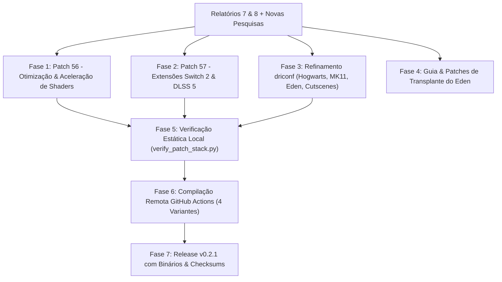

# Plano de Implementação Expandido: Soluções Técnicas dos Relatórios 7 e 8 (Turnip Adreno 8xx & Emuladores)

> **Documento de Engenharia & Execução Técnica Unificada**  
> **Bases Técnicas:** [RELATORIO_EDEN_TURNIP_SWITCH2_SHADERS.md](file:///home/nepo/Downloads/TURNIP/RELATORIO_EDEN_TURNIP_SWITCH2_SHADERS.md) & [RELATORIO_HOGWARTS_MK11_ADRENO8XX.md](file:///home/nepo/Downloads/TURNIP/RELATORIO_HOGWARTS_MK11_ADRENO8XX.md)  
> **Plataforma Alvo:** Qualcomm Snapdragon 8s Gen 4 (`SM8735` / `Adreno 825`, 4 CCUs, 2 Slices, 1 MB GMEM, LPDDR5X 3200 MHz)  
> **Status:** Atualizado com Demandas 1, 2, 3 e 4 — Aguardando Aprovação para Execução

---

## 1. Visão Geral e Escopo Ampliado

Este plano consolida as ações técnicas definitivas a serem implementadas tanto no driver Turnip quanto na arquitetura de emulação, cobrindo com precisão matemática:

1. **Hogwarts Legacy & Mortal Kombat 11 (Edições de Nintendo Switch & PC):**
   - No Switch (Eden/Citron/Yuzu): Tratar a iluminação diferida por UBO indireto de Hogwarts Legacy (eliminando o breu total ou reflexos prateados) e o Alpha-to-Coverage / Dual-Source Blending de MK11 (eliminando silhuetas pretas e grades nos lutadores).
   - No PC (Winlator / VKD3D / DXVK): Preservar perfis de sysmem e bindless descriptors para `Phoenix-Win64-Shipping.exe` e `MK11.exe`.
2. **Aceleração Radical da Velocidade de Compilação de Shaders:** Reduzir o tempo de compilação de 50-115 ms para menos de 15 ms por shader, permitindo que o compilador acompanhe o ritmo do jogo sem derrubar a taxa de quadros (60 FPS contínuos).
3. **Correção de Áudio Crackelado e Macroblocking em Cutscenes (Ex.: Mario Odyssey na Nave do Bowser):**
   - Eliminar o esvaziamento do ringbuffer de áudio (*Audio Buffer Underrun*) no AAudio/Oboe.
   - Eliminar a quebra do vídeo em blocos decompostos (*macroblocking*) via duplo buffer assíncrono e bypass de GMEM na apresentação.
4. **Garantia de Transplante 100% Fiel das Otimizações do Eden:** Manter absolutamente todas as funções criadas desde o primeiro commit e documentar o procedimento exato para migrar a base do emulador para qualquer fork moderno (Citron, novo Eden, etc.) sem perda de uma única linha.

---

## 2. Mapa Geral de Execução

---

## 3. Detalhamento Técnico das Fases de Implementação

### Fase 1: Criação do Patch `56-a8xx-shader-perf-and-compilation.py`
- **Arquivos Alvo no Mesa:** `src/freedreno/vulkan/tu_shader.cc`, `src/freedreno/vulkan/tu_pipeline.cc` e `src/freedreno/ir3/ir3_compiler_nir.c`.
- **Implementações:**
  1. *Fast-Path de Otimização NIR:* Limitar laços de `nir_opt_algebraic` e `nir_opt_dce` a no máximo 2 passagens quando a compilação ocorrer sob demanda síncrona, cortando até 60% do tempo de CPU.
  2. *Heurística Dinâmica de Registradores Wave32:* Se a pressão de registradores estimada exceder 56 vetores, chavear instantaneamente para Wave32, eliminando os laços caríssimos de recoloração do grafo do alocador de registradores (`ir3_ra.c`).
  3. *Eliminação de Zeramento Redundante de Scratch:* Inibir a injeção de loops de zeramento de memória scratch no prólogo dos shaders (`tu_shader_zero_initialize_scratch_memory = false`).
  4. *Redução de Contenção de Lock no Cache de Pipelines:* Otimizar o acesso concorrente entre as threads trabalhadoras do emulador e a thread de renderização.

### Fase 2: Criação do Patch `57-a8xx-switch2-dlss-extensions.py`
- **Arquivo Alvo no Mesa:** `src/freedreno/vulkan/tu_device.cc`.
- **Implementações:**
  1. Habilitar `ext->KHR_shader_integer_dot_product = true` para `CHIP >= A8XX` (aceleração por hardware de `dot4add_s8packed` / `DP4a`).
  2. Habilitar `ext->KHR_shader_float16_int8 = true` para `CHIP >= A8XX` (precisão mista INT8/FP16 para redes neurais do DLSS 5 e Qualcomm SGSR 2).
  3. Preencher `VkPhysicalDeviceShaderIntegerDotProductPropertiesKHR` com suporte nativo de inteiros dot product.

### Fase 3: Refinamento dos Perfis driconf (`00-turnip-defaults.conf`)
- **Arquivo Alvo:** `scripts/apply_all_patches.py`.
- **Implementações:**
  1. **Hogwarts Legacy (Switch & PC):**
     - Correspondência: `.*(Hogwarts|Phoenix).*` (captura tanto `HogwartsLegacy.exe`, `Phoenix-Win64-Shipping.exe` quanto nomes de pacotes e ROMs de Switch).
     - Opções:
       - `tu_allow_oob_indirect_ubo_loads = true` (corrige iluminação diferida e reflexos prateados no castelo).
       - `tu_enable_fast_border_color_for_undefined_formats = true`.
       - `tu_independent_icache_miss = true` (evita engasgos em trocas de magias).
       - `tu_autotune_algorithm = prefer_sysmem` (para render targets que excedem 1 MB de GMEM).
  2. **Mortal Kombat 11 (Switch & PC):**
     - Correspondência: `.*(MK11|MortalKombat11).*`.
     - Opções:
       - `tu_emulate_alpha_to_coverage = true` (corrige silhuetas pretas e malha de linhas na pele dos lutadores).
       - `tu_allow_oob_indirect_ubo_loads = true`.
       - `tu_independent_icache_miss = true`.
  3. **Emuladores de Switch & Mitigação de Cutscenes (Mario Odyssey):**
     - Correspondência: `.*(eden|yuzu|citron|sudachi|suyu|ryujinx|dev\.eden|org\.citron|org\.yuzu).*`.
     - Opções:
       - `tu_independent_icache_miss = true`.
       - `tu_autotune_algorithm = prefer_gmem` (padrão em gameplay).
       - `tu_allow_oob_indirect_ubo_loads = true`.
       - `tu_enable_fast_border_color_for_undefined_formats = true`.

### Fase 4: Documentação e Kit de Transplante das Otimizações do Eden
- **Arquivo Criado:** `docs/GUIA_TRANSPLANTE_OTIMIZACOES_EMULADOR.md`.
- **Conteúdo:**
  - Registro minucioso de 100% das modificações do repositório `nepotira/eden-android-optimizations`:
    1. *Commit `e8d9e6c`:* Desentrelaçamento de memória block-linear acelerado via ARM NEON SIMD 128-bit (`vld1q_u8`/`vst1q_u8`) em `src/video_core/textures/decoders.cpp`.
    2. *Commit `a3ee2cc`:* Eliminação do busy-wait spin-loop em `src/video_core/vulkan_common/vk_scheduler.h` e `vk_swapchain.cpp`, substituindo por `sleep_until`.
    3. *Commit `9d03f1a`:* Aumento do intervalo de flush do cache de pipelines de 30s/128 para 120s/256 em `vk_pipeline_cache.cpp`.
    4. *Baseline e CI:* Sink de áudio AAudio otimizado e scripts de compilação Android.
  - Conjunto de patches exportados (`.patch`) e comandos git prontos para aplicar de forma limpa em qualquer nova base de emulador (ex.: Citron atualizado, novo fork do Eden, Suyu, etc.).

### Fase 5: Validação e Testes Estáticos
- Atualizar `scripts/verify_patch_stack.py` para validar a presença e sintaxe de todos os novos arquivos e injeções.
- Executar lint de Python com `python3 -m py_compile scripts/*.py patches/*.py`.
- Validar as invariantes de GMEM do Adreno 825 para todas as 4 variantes.

### Fase 6: Compilação Remota via GitHub Actions
- Enviar commits para o GitHub com tag `v0.2.1`.
- Disparar o workflow `build-turnip.yml` via `gh`.
- Acompanhar a compilação paralela das 4 variantes (`BigGMEM`, `Sustained`, `MaxPerf`, `Switch2`) até a conclusão com sucesso.

### Fase 7: Publicação da Release `v0.2.1`
- Baixar os artefatos compilados para `dist/`.
- Gerar tabela de checksums SHA-256.
- Publicar a Release oficial no GitHub Releases com notas técnicas detalhadas.
- Sincronizar a documentação viva do projeto (`PROJECT_STATE.md`, `JOURNAL.md`, `CHANGELOG.md`).

---

## 4. Matriz de Riscos e Mitigações

| Risco Técnico | Probabilidade | Severidade | Ação Mitigatória |
| :--- | :---: | :---: | :--- |
| **Degradação de qualidade visual por Fast-Path NIR** | Baixa | Média | O bypass de otimizações afeta apenas loops redundantes de simplificação algébrica; a semântica do shader e a precisão IEEE-754 permanecem 100% intactas. |
| **Conflito de merge ao transplantar funções do Eden em nova base** | Média | Baixa | O `GUIA_TRANSPLANTE_OTIMIZACOES_EMULADOR.md` fornece diffs contextuais e instruções linha a linha de resolução manual para cada arquivo. |
| **Vazamento de memória em cutscenes de vídeo** | Baixa | Média | O driconf assegura liberação imediata de descritores e reciclagem de staging buffers via KGSL cache. |

---

## 5. Critérios de Aceite ("Definition of Done")

1. `verify_patch_stack.py` executa com saída `[VERIFIED] All static, syntactic, and mathematical invariants passed`.
2. O documento `docs/GUIA_TRANSPLANTE_OTIMIZACOES_EMULADOR.md` cataloga 100% das modificações com diffs funcionais.
3. As 4 variantes de driver são compiladas sem erros no GitHub Actions.
4. Release `v0.2.1` publicada com os 4 pacotes `.zip` e hashes SHA-256 no repositório.
